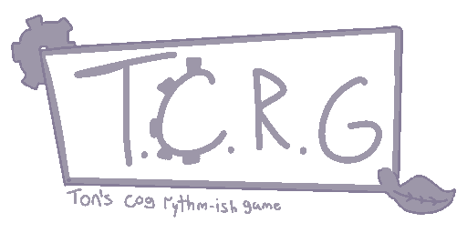

# T(on's) C(og) R(ythm-ish) G(ame)

TCRG is a 4 key (sort of) rythm game where you hit cogs (notes) with the corresponding arrow keys at the right moment :D

The game doesn't have music per say, which is why its a rythm-ISH game, instead, each cog plays a sound effect, and, with enough of them coming often enough, you kind of create music!! wowie!!

This project's theme is heavily inspired on [another project of mine](https://github.com/soggymoder/cotton) (not to do a shameless plug of course), which explains the choice of "cogs" for notes and ton as the mascot :D

## How do i play the game?

TCRG is a pretty easy and straight-forward game, as kind of explained in the above section, its a 4 key game that you play with each of your arrow keys - each cog has the shape of it's corresponding direction embued into it's design, but, if you can't tell it in game, the controls go like:

Yellow - Up

Blue - Left

Red - Right

Green - Down

(I inspired myself off the order of the colors for the buttons on an old XBOX controler i have :P)

On the main menu you can also choose what speed you want the game to be at and what "difficulty" you want to play in (all this does is select how many lives you have)

HUD wise, the C stands for Combo, S for Score, HC for highest combo, FS for final score and HS for highscore !!

## Credits, sort of

Besides the theme of the game being inspired by another project of mine, the overall (kind of) idea came from another rythm game im quite fond of, [Taiko no Tatsujin](https://www.bandainamcoent.com/games/taiko-no-tatsujin-rhythm-festival), so, thank you Taiko for being a thing i suppose xD

All of the assets in the game were hand drawn by me using my favourite drawing software [Krita](https://krita.org/en/) :D

## Tiny little disclaimer

As of writting this (25/11) the game is not yet finished, i still need to make a local storage for the high-score tracking and add sound effects to the game, these will be added in the very near future :D
